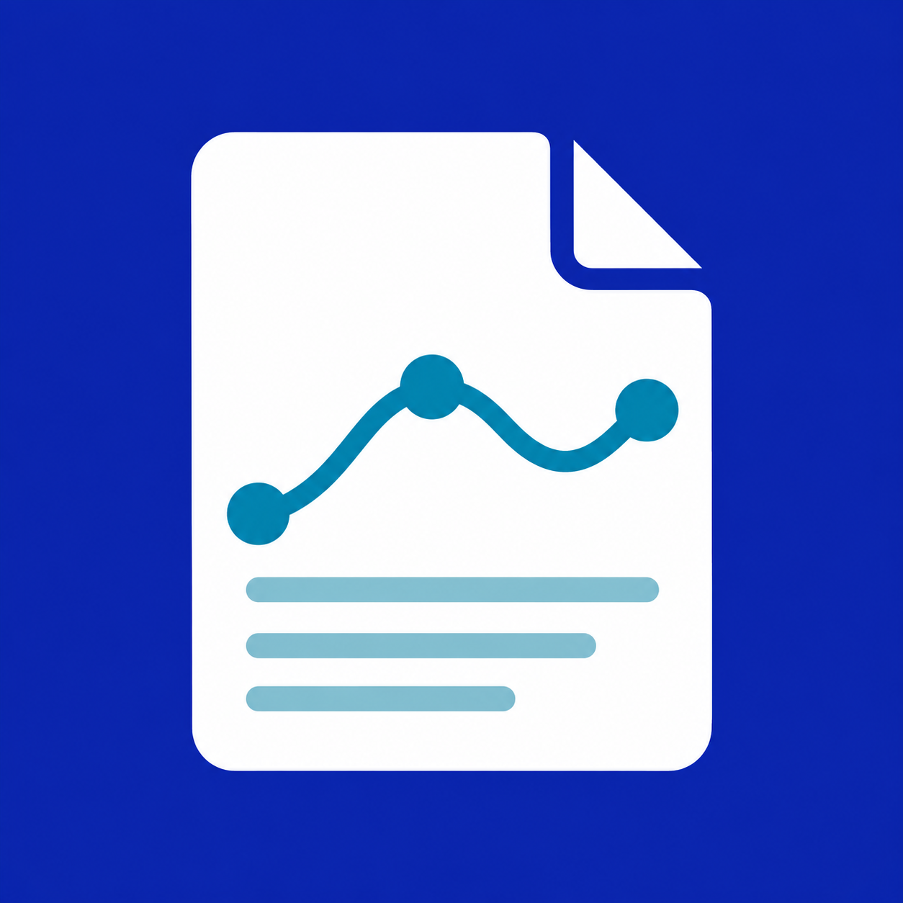

# 大学物理实验报告



把实验记录整理成清晰、规范的大学物理实验报告。

上传手写数据、表格或实验照片，核对数据、完成计算与拟合、绘制图表，再按报告纸的栏目排好正文、公式和结果。预习报告、数据处理、思考题或完整报告，都可以按需完成。

边看预览边调整，通过选区或批注修改具体内容；需要查阅时，可在线打开对应实验的教材章节。完成后导出可打印的 PDF 和配套文件，方便继续编辑与复算。

第一次使用会带你准备材料并完成设置。

## 可以帮你做什么

- **预习与思考题**：整理实验目的、原理和操作要点，按需完成指定栏目。
- **数据处理**：核对手写记录，完成单位换算、计算、拟合与不确定度分析。
- **图表与排版**：绘制实验图表，把正文、公式、表格放进报告纸对应栏目。
- **预览与修改**：审阅报告，通过选区、批注或引用原文逐段调整。
- **查阅教材**：在线打开对应实验的教材章节，也可以使用自己的材料。
- **导出与复算**：获得可打印的PDF和配套文件，方便后续编辑与检查。

## 安装

当前版本为 **v0.2.1**，通过私有插件源分发。先由维护者给你的 GitHub 账号授予本仓库访问权限，再在 Codex 中发送：

> 请从 GitHub 私有仓库 craftsfool/physics-lab-skill-release 添加插件源，安装其中的“大学物理实验报告”插件，然后带我完成首次设置。

也可以自行执行：

```
codex plugin marketplace add craftsfool/physics-lab-skill-release
codex plugin add physics-lab-report@physics-lab-private
```

已经添加插件源的电脑可以使用 [安装入口](codex://plugins/install/physics-lab-report?marketplace=physics-lab-private)。首次安装后打开新聊天，选择“大学物理实验报告”。

首次使用可按引导开通30天教材资料访问，也可直接使用自己的教材和实验记录。已经安装过旧技能时，旧文件会保留，新功能请选择插件本身。

## 分享给同学

当前还没有面向所有人的官方公共市场页面。上面的安装入口要求接收者先添加私有源，不能代替仓库授权。维护者也可以直接向接收者提供经过校验的私有安装包。

需要通过工作区分享或申请官方市场上架时，请看 [完整安装与分享说明](docs/installation.md)。本机文件路径链接不能直接用于其他电脑。

## 准备第一次报告

告诉插件实验名称和需要完成的部分，提供已有的实验记录、报告纸或教师要求。可以从一个栏目开始，不必一次准备齐所有材料。

预览与批注体验取决于使用的平台。桌面端适合边看边改；网页端以生成文件、下载和逐轮修改为主。

## 下载与更新

- [v0.2.1 私有安装包](https://github.com/craftsfool/physics-lab-skill-release/releases/tag/v0.2.1)
- [v0.2.0](https://github.com/craftsfool/physics-lab-skill-release/releases/tag/v0.2.0) 与 [旧技能 v0.1.8](https://github.com/craftsfool/physics-lab-skill-release/releases/tag/v0.1.8) 保留。

通过插件源安装后可更新到新版。私有安装包内不包含教材原文、资料库或个人凭据。
